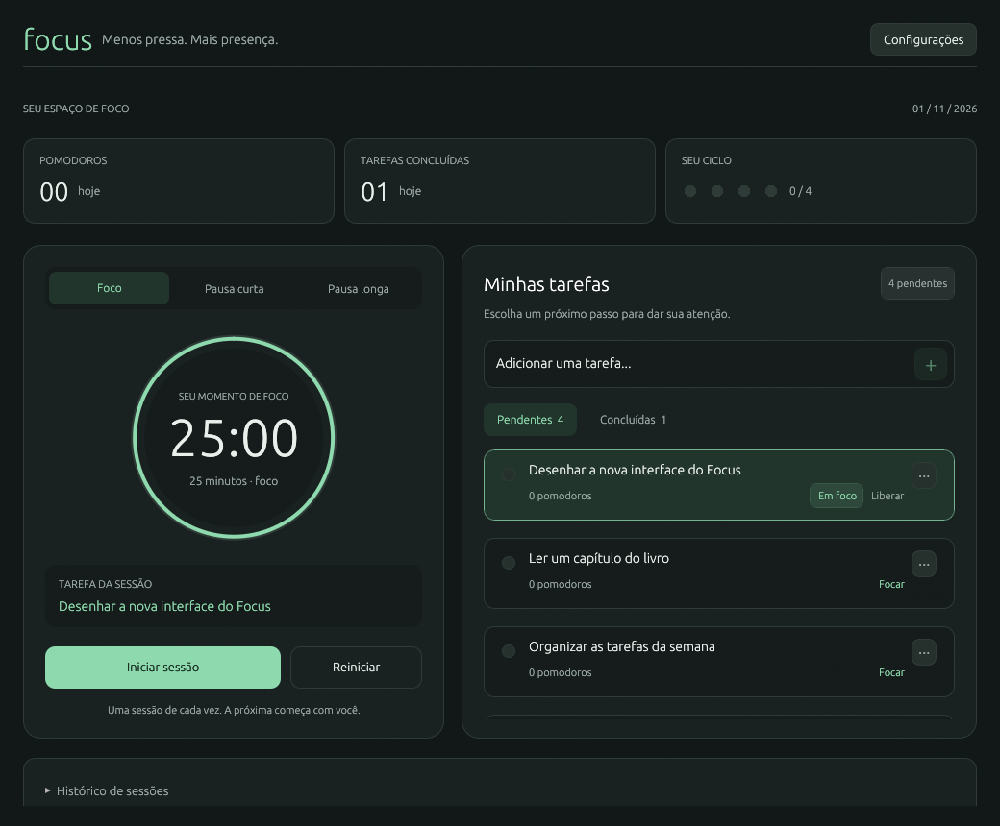

# Focus

Aplicativo desktop em Rust para Linux: temporizador Pomodoro e tarefas na mesma janela, em português. Funciona sem conta e sem internet após a instalação.

## MVP

- Criar, editar, excluir, concluir e reabrir tarefas.
- Selecionar uma tarefa para o foco ou iniciar uma sessão de foco livre.
- Iniciar, pausar, retomar e reiniciar sessões.
- Foco de 25 minutos, pausa curta de 5 e pausa longa de 15 após quatro focos concluídos. Durações configuráveis entre 1 e 180 minutos.
- Início manual de cada sessão. Também é possível escolher manualmente o tipo da próxima sessão.
- Avisos visuais, som incluído no binário e notificações do Linux.
- Progresso do dia e histórico recente, com contagem de pomodoros por tarefa.
- Dados locais, gravação atômica e bloqueio contra duas instâncias simultâneas.

## Interface

O cabeçalho mantém a identidade do Focus. O resumo do dia, o temporizador e as tarefas usam cartões com hierarquia de texto e controles maiores. A tarefa selecionada recebe destaque; a lista tem abas de pendentes e concluídas, e o menu `···` reúne edição e exclusão. O histórico fica recolhido abaixo dos painéis.

Em janelas amplas, temporizador e tarefas aparecem lado a lado. Abaixo de 800 pontos de largura útil, o conteúdo passa para uma coluna com rolagem.

### Modo compacto

Clique em **Modo compacto** no cabeçalho para acompanhar a sessão em uma janela de 360 × 330 pontos. O painel mostra o tipo de sessão, tempo restante, progresso e tarefa ativa, com controles para iniciar, pausar, retomar e reiniciar. Títulos longos exibem o texto completo ao passar o mouse.

**Expandir** volta à tela completa e restaura o tamanho anterior, incluindo o estado maximizado. A troca de modo mantém a mesma sessão e o mesmo tempo restante; uma sessão pausada continua pausada. O modo vale para a janela atual: ao abrir o aplicativo novamente, ele inicia na tela completa. Fechar a janela compacta mantém a regra de interromper a sessão.

Prévia do layout com dados de exemplo, renderizada sem janela:



## Arquitetura

Foi escolhido **egui/eframe**, usando OpenGL (`glow`) e os recursos `wayland` e `x11`. A interface é escrita em Rust, sem navegador incorporado ou GTK. O código só solicita atualizações periódicas durante o uso, sem um loop ocupado.

| Arquivo | Responsabilidade |
| --- | --- |
| `src/timer.rs` | Relógio monotônico, pausa, retomada e detecção única de conclusão |
| `src/model.rs` | Tarefas, sessões, ciclo de quatro focos e progresso diário |
| `src/storage.rs` | Caminhos XDG, JSON, gravação atômica e bloqueio de instância |
| `src/alerts.rs` | Notificação e som em threads, sem bloquear a interface |
| `src/ui.rs` | Janela principal, configurações e ações compartilhadas do temporizador |
| `src/ui/compact.rs` | Painel compacto e restauração do tamanho da janela |
| `src/main.rs` | Inicialização e recuperação de sessões interrompidas |

Implementação organizada em três etapas: núcleo e regras; interface e integrações Linux; testes e distribuição. O código das três etapas está incluído. A validação completa depende do download inicial das dependências.

Referências: [eframe](https://docs.rs/eframe/0.33.0/eframe/) e [especificação XDG](https://specifications.freedesktop.org/basedir/latest/).

## Compilar e executar

Requer Rust/Cargo **1.89 ou superior**, compilador C, `pkg-config` e bibliotecas de desenvolvimento do sistema. O primeiro build precisa de internet para baixar as crates.

Ubuntu/Debian:

```sh
sudo apt update
sudo apt install build-essential pkg-config libxkbcommon-dev libwayland-dev \
  libx11-dev libxi-dev libxrandr-dev libxcursor-dev libxinerama-dev \
  libgl1-mesa-dev libnotify-bin pipewire-bin
cargo run
```

Fedora:

```sh
sudo dnf install gcc gcc-c++ pkgconf-pkg-config libxkbcommon-devel \
  wayland-devel libX11-devel libXi-devel libXrandr-devel libXcursor-devel \
  libXinerama-devel mesa-libGL-devel libnotify pipewire-utils
cargo run
```

`notify-send` exige um serviço de notificações na sessão gráfica. O áudio tenta, nessa ordem, `pw-play`, `paplay` e `aplay`; basta um deles funcionando. Se você usa PulseAudio, pode instalar `pulseaudio-utils` em vez de `pipewire-bin` no Ubuntu/Debian. A ausência desses utilitários aparece como aviso no aplicativo, sem interromper o temporizador. Use **Configurações → Testar avisos** para verificar a integração.

Os backends Wayland e X11 estão habilitados. Para escolher explicitamente durante um teste:

```sh
# Em uma sessão Wayland:
env -u DISPLAY cargo run
# Em X11 ou via XWayland disponível na sessão:
env -u WAYLAND_DISPLAY cargo run
```

É necessária uma sessão gráfica e um driver com OpenGL. Não há execução em segundo plano após fechar a janela.

## Uso e regras

1. Adicione uma tarefa e clique em **Focar**, ou use foco livre.
2. Clique em **Iniciar sessão**. **Pausar** conserva o tempo restante; **Retomar** continua a mesma sessão.
3. Ao terminar, o aplicativo registra a sessão, avisa e prepara o próximo tipo. A próxima sessão aguarda seu comando.
4. **Reiniciar** interrompe a sessão e devolve seu tempo à duração inicial. Sessões interrompidas e pausas não contam como pomodoros.

A seleção da tarefa fica bloqueada durante uma sessão, inclusive quando pausada. Para trocar de tarefa, reinicie a sessão. A tarefa ativa só pode ser concluída ou excluída depois disso. Editar o título não modifica os títulos já registrados no histórico.

Fechar a janela durante uma sessão registra uma interrupção. Após uma queda ou encerramento forçado, sessões em aberto são recuperadas como interrompidas; nenhum foco é concluído por inferência. O temporizador usa `Instant`, portanto atrasos da interface não acumulam erro. No Linux, tempo em suspensão do sistema não entra na contagem do relógio monotônico. O aplicativo precisa estar aberto para emitir os avisos.

O progresso diário usa a data local da conclusão. Excluir uma tarefa preserva suas conclusões e sessões no histórico. Reabrir uma tarefa remove sua marca de conclusão e permite concluí-la novamente. A interface mostra as últimas 30 sessões; o arquivo local conserva o histórico completo. Mudanças nas durações não alteram uma sessão em andamento.

## Dados locais

| Conteúdo | Local padrão |
| --- | --- |
| Configurações | `~/.config/focus/settings.json` |
| Tarefas, sessões e progresso | `~/.local/share/focus/state.json` |
| Som e bloqueio de instância | `~/.local/share/focus/` |

`XDG_CONFIG_HOME` e `XDG_DATA_HOME` substituem as bases padrão quando contêm caminhos absolutos. Os JSONs são legíveis e podem ser copiados para backup com o aplicativo fechado. Arquivos inválidos causam erro de inicialização, sem serem sobrescritos. Falhas de gravação aparecem na interface com opção de tentar novamente.

## Verificações

```sh
cargo fmt --all -- --check
cargo test
cargo clippy --all-targets -- -D warnings
```

Os testes cobrem atraso entre atualizações, pausa/retomada, conclusão única, ciclo e pausa longa, tarefas, recuperação, persistência, arquivos inválidos e bloqueio de instância.

**Validação da interface atual:** o aplicativo compila e passa no Clippy sem avisos. Quatorze testes do temporizador, modelo, fluxo de sessão e modo compacto foram executados com `rustc`, usando as dependências já compiladas. Os testes do modo compacto verificam a preservação de sessões ativas e pausadas, a restauração de tamanho e estado maximizado, o redimensionamento após confirmação do compositor e os controles no tamanho mínimo da janela. A suíte completa do Cargo permanece pendente porque `fastrand`, usado pelos testes de persistência, não está no cache e o registro está inacessível neste ambiente. A revisão visual foi feita por renderização sem janela em larguras de 1040 e 680 pontos; a abertura de uma janela nativa não pôde ser testada por falta de acesso ao compositor Wayland e ao servidor X11. O `Cargo.lock` está incluído para fixar as dependências.

Teste manual recomendado após compilar: configurar durações de 1 minuto; concluir quatro focos intercalados por pausas; conferir a pausa longa, as contagens e os avisos; pausar/retomar; fechar durante uma sessão e reabrir; verificar as tarefas em Wayland e X11.

## Distribuição e instalação local

```sh
cargo build --release
./target/release/focus
# Gera target/dist/focus-linux-<arquitetura>.tar.gz:
make dist
# Compila e instala em ~/.local/bin e no menu de aplicativos:
make install
```

O pacote contém o executável, o README, o arquivo `.desktop` e o ícone. Fontes da interface e som estão incorporados ao executável. As bibliotecas do sistema e os utilitários de notificação/áudio continuam necessários. O binário usa a glibc do ambiente de compilação: gere a distribuição na versão mais antiga do Linux que pretende suportar, para cada arquitetura desejada.

Para usar o atalho do menu, mantenha `~/.local/bin` no `PATH` da sessão gráfica. Após extrair o pacote, você também pode executar `./focus` diretamente. `make install` aceita `PREFIX` e `DESTDIR` para preparar outro destino sem instalar no sistema durante o desenvolvimento.
